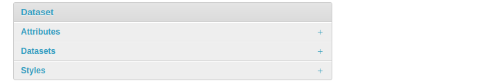
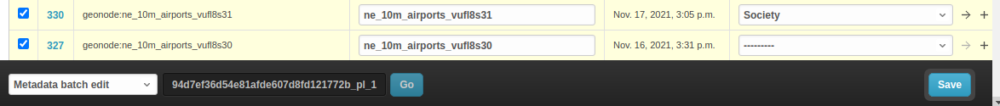
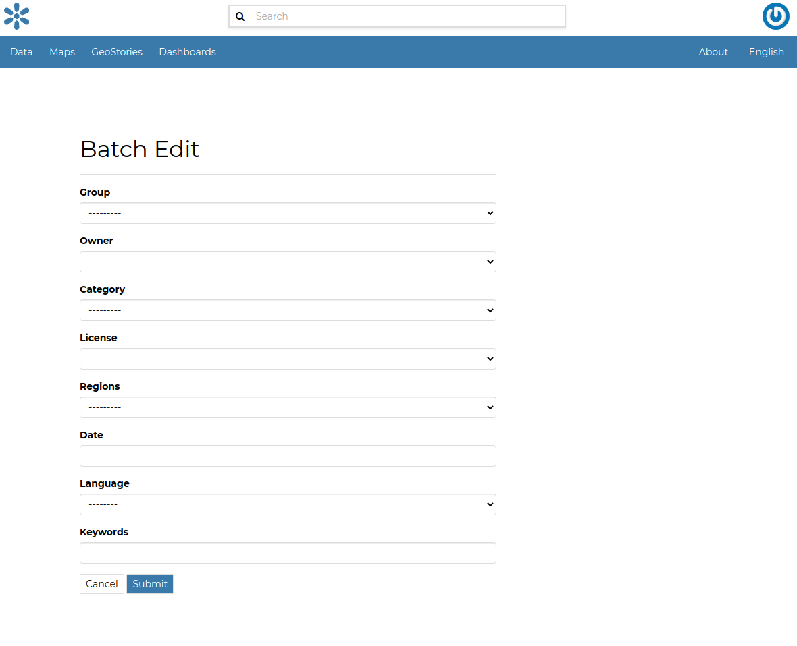
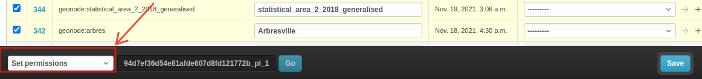
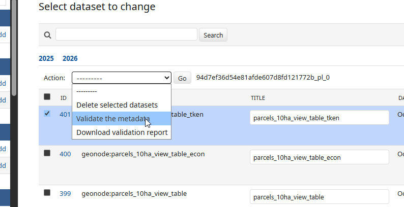
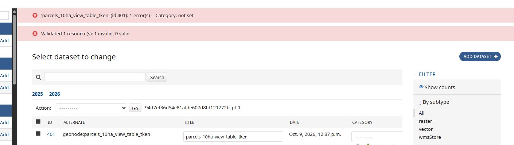

# Manage datasets using the admin panel

Some dataset information can be edited directly through the admin interface, although the best place to do that in GeoNode is `Dataset -> Metadata Edit`.

Clicking on the `Admin > Dataset > Datasets` link shows the list of available datasets.

{ align=center }

!!! Warning
    It is not recommended to modify the datasets' `Attributes` or `Styles` directly from the Admin dashboard unless you are fully aware of your actions.

The `Metadata` information can be changed for multiple datasets at once through the `Metadata batch edit` action. Select the datasets you want to edit in the batch and, at the bottom, choose the `Metadata batch edit` action, then click `Go`.

{ align=center }

This opens a form with the information you can edit in batch, as shown below.

{ align=center }

By clicking on a dataset link, a detail page opens that allows you to modify some of the resource information such as the metadata, keywords, title, and more.

!!! Note
    It is strongly recommended to always use the GeoNode resource `Edit Metadata` or `Advanced Metadata` tools in order to edit metadata information.

The `Permissions` can also be changed for multiple datasets at once through the `Set permissions` action.

{ align=center }

By clicking on a dataset link, a detail page opens that allows you to modify the permissions for the selected resource.

## Validating the metadata

Select one or more datasets and choose the `Validate the metadata` action to check them against the metadata `jsonschema`.

{ align=center }

The outcome is reported as admin messages: a summary line, one line per invalid dataset describing its errors, and a warning for any field the schema itself does not let be left empty.
To keep the page readable, only the first messages are shown when many datasets are selected.

{ align=center }

The `Download validation report` action runs the same validation but, instead of posting admin messages, returns the full result as a downloadable JSON file, with nothing capped or left out.
Use it whenever the selection is too large for the `Validate the metadata` messages to show everything, or when the report needs to be kept or processed afterwards.

Both actions are also available on the `Maps`, `Documents` and `Geo Apps` admin pages, and from the command line through the `validate_metadata` management command, which also supports CSV output and validating against an arbitrary schema or instance file.
